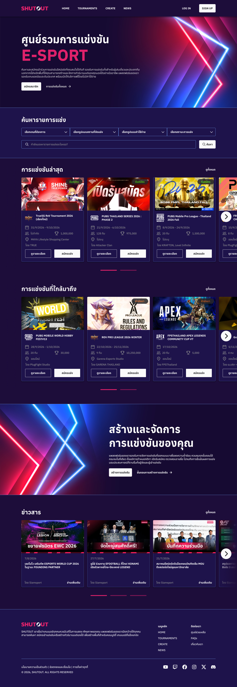

# 🎮 SHUTOUT — E-Sport Tournament Platform (Prototype)

**SHUTOUT (ชัทเอาท์)** คือเว็บไซต์ต้นแบบ (Multi-page Prototype) ที่รวบรวมรายการแข่งขัน E-Sport ภายในประเทศไทย ออกแบบมาเพื่อเป็นพื้นที่กลางให้ทั้งผู้เล่นทั่วไป ผู้เล่นระดับมืออาชีพ และผู้จัดการแข่งขัน สามารถค้นหา สมัครลงแข่ง หรือสร้างทัวร์นาเมนต์ของตัวเองได้

> 📌 **Project Context:** ผลงานรายวิชา Web Design and Development โดย **นางสาวอัจฉราพร ไชยลังกา (นักศึกษามหาวิทยาลัยศิลปากร คณะเทคโนโลยีสารสนเทศและการสื่อสาร สาขาเทคโนโลยีดิจิทัลเพื่อการออกแบบ เอกการออกแบบอินเทอร์แอคทีฟแอปพลิเคชัน รหัสนักศึกษา 681310310)**

---

## 🌐 Live Demo & Screenshots

* **Live Demo:** `[ใส่ลิงก์ GitHub Pages ของคุณที่นี่]`
* **Design System & Concept:** ดูรายละเอียดแนวคิดการออกแบบ โลโก้ และคู่สีได้ที่ [DESIGN.md](./DESIGN.md)
* **Future Upgrade Plan:** ดูแผนการพัฒนาต่อยอดสู่ Full-Stack ได้ที่ [ROADMAP.md](./ROADMAP.md)

| Homepage | Tournament Detail & Registration |
| :---: | :---: |
|  |  |

---

## 💡 Core Concept

1. **OPPORTUNITY:** เปิดโอกาสให้ผู้เล่นทุกคนสามารถเข้าถึงและลงแข่งขันในเกมที่รักเพื่อต่อยอดสู่เส้นทางมืออาชีพ
2. **COMMUNITY:** ศูนย์รวมคอมมูนิตี้สำหรับผู้ที่สนใจการแข่งขันและการจัดทัวร์นาเมนต์ E-Sport ทุกระดับ
3. **CREATE:** เปิดพื้นที่ให้ผู้จัดสามารถสร้างรายการแข่งขัน กำหนดกติกา และบริหารจัดการทัวร์นาเมนต์ได้ด้วยตนเอง

---

## ✨ Key Features (Current Prototype — 90% Completed)

### 1. Homepage (`index.html`)
* **Hero Section & Navigation:** แถบนำทางหลัก (Home, Tournaments, Create, News, Login/Sign Up) และแบนเนอร์ประชาสัมพันธ์หลัก
* **Tournament Search & Filter UI:** ส่วนค้นหาและคัดกรองรายการแข่งขันตามเกม รูปแบบสถานที่ รูปแบบค่าใช้จ่าย และสถานะการแข่งขัน
* **Interactive Carousel (Swiper.js):** สไลเดอร์แสดงรายการแข่งขันในช่วงนี้ การแข่งขันที่ใกล้มาถึง และข่าวสารวงการ E-Sport

### 2. Tournament Detail & Registration (`feature.html`)
* **Tab Switching System:** ระบบสลับแท็บเนื้อหาแบบไดนามิกด้วย JavaScript แบ่งเป็น 4 หมวดหมู่: **รายละเอียด (Details)**, **ผู้เข้าร่วม (Participants)**, **ตารางแข่ง (Schedule)** และ **ผลลัพธ์ (Results)**
* **Dynamic Team Registration Form:**
  * กรอกข้อมูลทีมและผู้ติดต่อหลัก (ชื่อ-นามสกุล, อีเมล, เบอร์โทรศัพท์)
  * **Dynamic Player Fields:** เพิ่ม/ลดรายชื่อสมาชิกในทีม (ขั้นต่ำ 4 คน) พร้อมกรอกชื่อในเกมและ UID รวมถึงปุ่มเพิ่มผู้เล่นสำรอง
  * **Dynamic Coach Fields:** รองรับการเพิ่มข้อมูลโค้ชทีมสูงสุด 2 คน
  * **Interactive Button States:** มีสถานะ Hover, Active, Disable และเปลี่ยนสถานะเป็น *"สมัครรายการแข่งนี้แล้ว"* เมื่อกดยืนยันการสมัคร

---

## 🛠️ Tech Stack

* **Structure & Styling:** HTML5, CSS3 (Custom Properties, Flexbox/Grid, Interactive States)
* **Interactivity:** Vanilla JavaScript (DOM Manipulation, Dynamic Form Fields, Tab Switching)
* **Libraries & Fonts:** [Swiper.js](https://swiperjs.com/) (Carousel Slider)[cite: 16], Google Fonts (`Kanit` & `Anuphan`)

---

## 🚀 Getting Started

1. **Clone the repository:**
   ```bash
   git clone https://github.com/ST2415/Shutout.git
